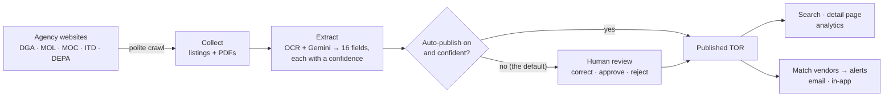

# City of Software

**Find Bangkok's software tenders while there is still time to act on them.**

[](https://github.com/KUINFOT/City_Of_Software/actions/workflows/ci.yml)

City of Software (the *BMA TOR Portal*) is a discovery and alert platform for software procurement by Thai government agencies. It watches agency websites for new draft TORs and tender announcements, reads the PDFs with AI, has a person check the result, and then tells the vendors who could actually bid.

> **New to the vocabulary?** A **TOR** is a *Terms of Reference*: the document an agency publishes to say what it wants built. The [glossary](docs/glossary.md) explains the rest (BMA, e-GP, Buddhist Era dates, "pre-award", and so on).

## Why it exists

Awarded-contract data is easy to find, and it is useless to a vendor looking for work: the contract is already signed.

The opportunities live earlier. A *draft TOR* is open for public comment, or a tender has just opened for bids. That information sits on individual agency websites, in inconsistent formats, often as scanned PDFs, and most of it is only actionable for a few days. Nobody checks six government sites every morning.

City of Software does that for you, puts the result in one searchable place, and puts the deadline on top.

## What you can do with it

### As a vendor

- **Search and browse** every reviewed TOR by keyword, agency, budget, status, deadline, technology and project type. A search is just a URL, so you can bookmark it or send it to a colleague.
- **Read a standardised summary** next to the original document, with a warning on any field the AI was not sure about.
- **Check yourself against the requirements.** Your declared certifications, past contract value and years of experience are compared with the TOR's stated thresholds. The platform never says "eligible" or "ineligible"; that decision belongs to the agency.
- **Get alerts** when a TOR that matches you opens for public comment, and again when it is formally announced. Choose instant emails or a daily digest, follow extra agencies and keywords, and unsubscribe in one click.
- **Keep a shortlist.** Save TORs with private notes, compare two to four side by side, plan around a deadline calendar, and print or save a summary as PDF.
- **Price a bid with evidence.** See historical budgets for comparable projects, how often each agency buys software and at what size, and which postings look statistically unusual.

### As an administrator

- **Review before anything is published.** Every extracted TOR waits in a queue with its original document beside it. Correct a field, approve, reject with a reason, or resolve a duplicate. Auto-publish exists but is **off by default**.
- **Watch the crawlers.** See which agency sites are healthy, stale or broken, and trigger a run by hand.
- **Control access.** Manage accounts and roles, and read an audit log of every human decision.

## How it works



1. **Collect.** Per-site adapters read the listing pages politely (rate-limited, `robots.txt`-aware) and download the attached PDFs.
2. **Extract.** Gemini reads each document and returns structured fields, and every value must be backed by a quote from the source or it is thrown away. Anything unsure gets a low confidence.
3. **Review.** A person checks the result, because nobody should act on a bad reading of a scanned page.
4. **Publish and notify.** Only approved records are visible to vendors. When a published TOR moves to a new stage, matching vendors are alerted.

The full tour is in [docs/architecture.md](docs/architecture.md).

## Status at a glance

| Area | Where it stands |
| --- | --- |
| Accounts, vendor profiles, sign-in | ✅ Built. Sign-up and password-reset emails need Gmail or Resend credentials; without them the link is printed in the API's terminal. |
| Search, browse, TOR detail | ✅ Built, on reviewed (published) TORs. |
| Saved TORs, notes, compare, calendar | ✅ Built. |
| Pricing analytics | ✅ Built. Reports "not enough data" until a comparable set has at least 5 records. |
| Crawling | ✅ Five sources work. A sixth (eGP BMA2) is blocked by its Terms of Service. The daily schedule is **off** until you set `SCHEDULER_ENABLED=true`. |
| AI extraction | ✅ Built. Needs Google Cloud credentials; without them the API runs on safe stubs and sends every record to manual review. |
| Alerts | ⚙️ Built, but needs email credentials and is triggered by crawls ([details](docs/notifications-and-matching.md#when-an-alert-is-sent)). |
| Admin tools | ✅ Review queue, field correction, adapter health, accounts and roles, audit log. ⚠️ Manual TOR upload has no screen yet (API only), and "Export repository" is a demo that downloads sample data. |

The honest, itemised version, including known gaps, is in [docs/status.md](docs/status.md).

## Quick start

You need **Node.js 22 or newer** and a **MongoDB connection string** (a free [MongoDB Atlas](https://www.mongodb.com/atlas) cluster is plenty).

```bash
# 1. The API
cd back-end
npm install
cp .env.example .env        # then set MONGODB_URI in .env
npm run dev                 # http://localhost:4000/api/health
```

```bash
# 2. The web app (in a second terminal)
cd front-end
npm install
npm run dev                 # http://localhost:3000
```

Everything else is optional for local work. With no Google Cloud credentials the AI steps use stubs, and with no email credentials the verification link is printed in the API terminal instead of being sent.

> **An empty database shows an empty site.** [Getting started](docs/getting-started.md) walks through pulling in real TORs, creating your first admin, and approving something so you have data to look at.

### Or run it all with Docker

```bash
cp .env.example .env        # fill in MONGODB_URI and AUTH_SECRET
docker compose up --build -d
```

Open <http://localhost:3000>. The [deployment guide](docs/deployment.md) covers configuration, the scheduler, backups and updating.

## Repository map

```
City_Of_Software/
├── back-end/              Express + TypeScript API, crawler, AI extraction, scheduler
│   └── src/
│       ├── routes/ controllers/ middleware/ models/   the HTTP layer and the data model
│       ├── extraction/    site adapters and the crawl → extract → review pipeline
│       ├── analytics/     pricing analytics, outlier maths, key dates
│       ├── matching/      qualification check and "why did this match me"
│       ├── notifications/ alert fan-out, daily digest, email templates
│       ├── scheduler/     cron wiring and the overlap lock
│       └── services/      sessions, passwords, email, Document AI, Gemini
├── front-end/             Next.js app with a Thai-language UI
├── docs/                  the documentation index is docs/README.md
├── docker-compose.yml     the whole stack in one command
└── .github/workflows/     CI: type-check, tests, build, Docker health check
```

## Documentation

| I want to… | Read |
| --- | --- |
| Get it running and see real data | [Getting started](docs/getting-started.md) |
| Use it as a vendor | [Vendor guide](docs/guides/vendor-guide.md) |
| Run the admin side | [Admin guide](docs/guides/admin-guide.md) |
| Understand how the pieces fit | [Architecture](docs/architecture.md) |
| Call the API | [API reference](docs/api-reference.md) |
| See every setting | [Configuration](docs/configuration.md) |
| Deploy it | [Deployment](docs/deployment.md) |
| Work on the code | [Development guide](docs/development.md) |
| Fix something that is broken | [Troubleshooting](docs/troubleshooting.md) |
| Look up a term | [Glossary](docs/glossary.md) |

The deeper design documents are [Authentication](docs/authentication.md), [Notifications and matching](docs/notifications-and-matching.md), [Analytics](docs/analytics.md), [Extraction pipeline](docs/extraction-pipeline.md) and [Database design](docs/database-design.md). Per-package notes live in [back-end/README.md](back-end/README.md) and [front-end/README.md](front-end/README.md).

## Tech stack

| Layer | Technology |
| --- | --- |
| Front-end | Next.js 15 (App Router) · React 19 · TypeScript · Lucide icons |
| Back-end | Node.js 22 · Express 4 · TypeScript · Mongoose 9 |
| Database | MongoDB Atlas |
| AI | Google Cloud Document AI (OCR fallback) · Gemini via the `@google/genai` SDK |
| Crawling | `cheerio` · `node-cron` · per-site adapters |
| Email | Gmail SMTP (`nodemailer`) or Resend |
| Packaging | Docker (multi-stage, non-root) · Docker Compose |

## Tests and CI

```bash
cd back-end  && npm run typecheck && npm test            # 200+ unit tests in about 5 seconds
cd front-end && npm run typecheck && npm run build
```

The back-end tests need no database and no Google account. CI runs the same checks on every pull request and also builds both Docker images and waits for them to report healthy. More in the [development guide](docs/development.md).
