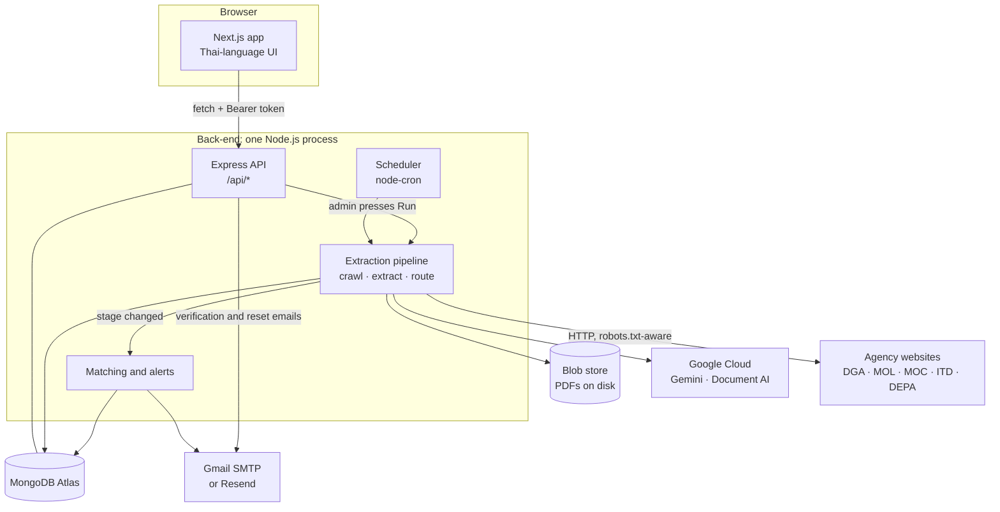
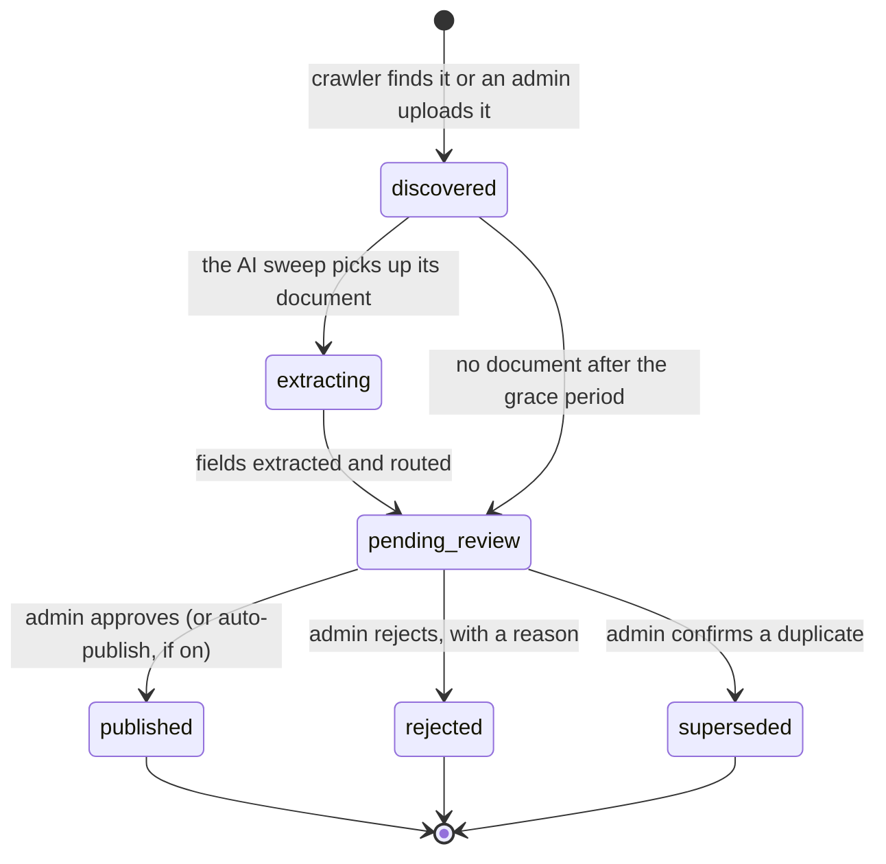

# Architecture

The five-minute tour: what the pieces are, how a government PDF becomes an alert in a vendor's inbox, and why the system is shaped the way it is.

**In one sentence:** a crawler and an AI extractor fill a MongoDB database with TORs; a human approves them; a read-only API and a Next.js app let vendors find them; a matching engine tells the right vendors when something changes.

---

## The parts



| Part | What it is | Worth knowing |
| --- | --- | --- |
| **Web app** (`front-end/`) | Next.js 15 App Router, React 19, Thai-language UI | Every page is client-rendered. The browser calls the API directly with `fetch`; there is no server-side data fetching and no proxy. That is why the API's `CORS_ORIGIN` must contain the web app's origin, and why `NEXT_PUBLIC_API_URL` is baked into the JavaScript at build time. |
| **API** (`back-end/src/routes`, `controllers`) | Express 4 under `/api` | Stateless apart from the database. Authentication is a Bearer token ([details](authentication.md)). |
| **Extraction pipeline** (`back-end/src/extraction`) | Site adapters, normaliser, attachment downloader, AI sweep | Crawling and AI extraction are two separate jobs on purpose ([why](#2-crawl-and-extract-are-separate-jobs)). |
| **Scheduler** (`back-end/src/scheduler`) | `node-cron` inside the API process | Off unless `SCHEDULER_ENABLED=true`. Runs eight jobs ([table below](#scheduled-jobs)). |
| **Matching and alerts** (`matching/`, `notifications/`) | Pure matching functions plus the email fan-out | Triggered by the crawler noticing a stage change ([details](notifications-and-matching.md)). |
| **MongoDB Atlas** | The only database | 16 collections ([database design](database-design.md)). Not part of the Docker stack. |
| **Blob store** | PDFs written to `EXTRACTION_STORAGE_DIR` | Content-addressed by SHA-256, so the same file is stored once. Local disk today; the code sits behind a `BlobStore` interface so object storage can replace it. |
| **Google Cloud** | Gemini reads PDFs and images directly; Document AI is the OCR fallback | Optional. With `GCP_PROJECT_ID` unset every AI call returns a safe, zero-confidence stub. |
| **Email** | Gmail SMTP, else Resend, else a console log (development only) | In production, sending with none configured is an error. |

---

## The life of a TOR

A TOR moves through two separate state machines. Keeping them apart is the single most important idea in the data model.

- **`status`** is *our* workflow: has anyone looked at this yet, and may vendors see it?
- **`lifecycle.stage`** is *the agency's* procurement stage: is this a draft, is bidding open, has it been awarded?

A TOR can be `published` here while still `bidding_open` at the agency. The two answer different questions and change for different reasons.



> [!NOTE]
> `closed` and `archived` exist in the schema for later use, but **nothing sets them yet**. A published TOR whose submission deadline has passed is simply hidden from the default listings at read time. See [status](status.md).

### A walk-through

This is an illustrative path, not a log of a real record.

1. **Collect.** At 03:00 the scheduler runs the Ministry of Labour adapter. It reads the draft-TOR listing, converts Buddhist Era dates (`18 สิงหาคม 2569`) to calendar dates, and classifies each title (`draft_tor`, `bidding_open`, `awarded`, …) with a priority-ordered keyword table. Each row becomes a `RawListing`, the only contract between adapters and the rest of the system.
2. **Normalise and store.** The row is upserted into `tors` using a stable `identityKey`. A new one starts at `status: discovered`. A content hash lets later runs skip rows that have not changed. Attachments are downloaded (after a `robots.txt` check), hashed, written to the blob store and recorded as `documents` with `status: uploaded`.
3. **Duplicate check.** A newly created TOR is compared with the existing corpus. Anything suspiciously similar is *linked* as a candidate; nothing is ever merged automatically.
4. **Extract.** Every 30 minutes the AI sweep takes the oldest `uploaded` documents. Gemini reads the PDF and returns 16 fields, each with a confidence and a verbatim quote from the document as evidence. A field whose quote cannot be found in the document is discarded. An overall confidence is **recomputed in code**, never taken from the model.
5. **Route.** With the shipped settings every record goes to `pending_review`. Auto-publish needs `EXTRACTION_AUTO_PUBLISH_ENABLED=true` *and* a confidence above the stricter threshold, and an already-awarded TOR can never auto-publish.
6. **Review.** An administrator opens the queue, reads the original beside the extracted fields, corrects what is wrong (corrected fields are locked against later re-extraction), and approves. The decision is written to the audit log.
7. **Serve.** The TOR now appears in search, browse, the detail page, the calendar and the analytics.
8. **Notify.** If a later crawl sees a *published* TOR change stage, for example `draft_tor` → `bidding_open`, vendors whose profile matches are alerted and each notification keeps a snapshot of why.

---

## How the back-end is organised

```
back-end/src/
├── index.ts          boot: connect to MongoDB, start the scheduler, listen
├── app.ts            Express app: CORS, logging, body parsing, /api, error handlers
├── routes/           URL → middleware → controller (one file per feature)
├── controllers/      HTTP in, HTTP out: validate input, call domain code, shape JSON
├── middleware/       auth guards, file upload (20 MB, in memory), error handling
├── models/           Mongoose schemas
├── services/         talking to the outside: sessions, passwords, email, Gemini, Document AI
├── extraction/       registry · adapters/ · core/ · pipeline/ · cli.ts
├── analytics/        budget comparison, agency frequency, outlier maths, key dates
├── matching/         qualification check, match reasons
├── notifications/    stage-change fan-out, daily digest, email templates
├── scheduler/        cron expressions, overlap lock
├── config/           environment, database, Google Cloud settings
└── scripts/          seedDocuments.ts (legacy demo seed)
```

### A request, end to end

1. The browser calls the API (`NEXT_PUBLIC_API_URL` plus a path such as `/tors/…`), with an `Authorization: Bearer …` header when signed in.
2. Express applies CORS (the origin must be in `CORS_ORIGIN`), request logging (`morgan`) and body parsing (JSON and URL-encoded).
3. `/api` dispatches to a feature router. Protected routes run an auth guard first: `requireAuthenticated`, `requireVendor`, `requireAdmin` or `requireSelfOrAdmin`.
4. The controller validates the input, reads or writes Mongoose models, and delegates anything non-trivial to a domain module.
5. Errors go to `next(err)` and become `{ "error": "…" }` with status 500. An unknown route returns 404 with the same shape.

Every protected request does a real database check. The signed token is verified, then the matching `Session` document must be unrevoked and not idle-expired (and has its sliding window refreshed), then the `User` must be `active` with the same `sessionVersion`. That is what makes logout, suspension and role changes take effect immediately. See [authentication](authentication.md).

### Scheduled jobs

All of them are registered by `scheduler/index.ts`, only when `SCHEDULER_ENABLED=true`, and only after MongoDB connects. Each runs under a named lock so a slow run is not started twice.

| Job | Default (`cron`) | Does |
| --- | --- | --- |
| Crawl **DGA** | `0 2 * * *` | Daily 02:00. Runs with attachments. |
| Crawl **MOL** | `0 3 * * *` | Daily 03:00. Public-comment windows are short, so daily matters. |
| Crawl **MOC** | `0 4 * * *` | Daily 04:00. |
| Crawl **ITD** | `0 5 * * *` | Daily 05:00. |
| Crawl **DEPA** | `0 6 * * 1` | Mondays 06:00. One page load, few new rows. |
| AI extraction sweep | `*/30 * * * *` | Every 30 minutes. Up to `EXTRACTION_SWEEP_BATCH_SIZE` documents. |
| Outlier analysis | `0 7 * * *` | Daily 07:00. Recomputes outlier flags and `procurement_stats`. |
| Daily digest | `0 8 * * *` | Daily 08:00. One email per digest-frequency vendor. |

Times are read in the process time zone (`Asia/Bangkok` in Docker). The eGP BMA2 source is **never** scheduled; see [the compliance gate](extraction-pipeline.md#5--the-source-registry-and-the-compliance-gate).

### Where state lives

| Store | Holds | Notes |
| --- | --- | --- |
| MongoDB | All records | Notifications expire after 180 days; sessions and tokens carry TTL indexes. |
| Blob store (disk) | Downloaded PDFs | In Docker, the `tor-storage` volume. **Back it up**; it is not in MongoDB. |
| Browser `localStorage` | `city-of-software-user`: the signed-in user and token | Cleared on sign-out and after 30 minutes of inactivity. |
| Browser `sessionStorage` | `city-of-software-registration-draft`, `city-of-software-vendor-profile-draft` | The sign-up steps. Cleared when email verification completes. |
| Process memory | The scheduler's overlap lock | Why you must run **exactly one** back-end. |

---

## Design decisions, and why

These are the choices a newcomer is most likely to question. Each has a reason that is not obvious from the code.

### 1. Two lifecycles, not one

An earlier version had a single `status` enum that mixed our review states with agency-side values like `awarded` and `cancelled`. Those duplicated what `lifecycle.isAwarded` and `lifecycle.stage` already recorded, which left two places that could disagree about whether something was awarded. Now `status` only describes our workflow, and the agency's stage lives in `lifecycle`.

### 2. Crawl and extract are separate jobs

A crawl has to be quick and polite: a daily cadence, never degrading search. A single document's OCR and extraction can take minutes. Entangling them would let one slow PDF stall an entire agency's crawl and would mix two unrelated failure types in one job record. So `ScrapeJob` records a crawl, `ExtractionJob` records one document's extraction, and a `Document` row with `status: uploaded` is the hand-off between them.

### 3. "Absent stays absent"

A missing budget is not zero, a missing date is not today, and an unknown award state is not "not awarded". Wherever a fact can be unknown the type is tri-state (`isAwarded: true | false | null`, `outlier.isOutlier: true | false | null`) and missing values are *excluded and counted*, never defaulted. About 65% of DEPA's archive is direct-appointment procurement, which legally skips the public TOR and bidding stages and so never states one. Collapsing "unknown" into "not awarded" would have presented 549 unclassifiable rows as actionable tenders.

### 4. Safe by default, human in the loop

- With no Google credentials, every AI call returns every field `null` at confidence `0`, which routes to review. Nothing can publish by accident.
- Auto-publish is off, and even when on it needs *two* thresholds and is blocked for awarded TORs.
- A field the model cannot back with a verbatim quote from the source is discarded, not "partially trusted".
- Fields a human corrected are recorded and never overwritten by a re-run.
- The read endpoints re-check `status: published` themselves, so a bug elsewhere cannot leak an unreviewed record.

### 5. Politeness and compliance are structural

Honest `User-Agent`, at least one second between requests per host, `robots.txt` checked for downloads as well as pages, retries with backoff. One source (eGP BMA2) has Terms of Service that forbid crawling; it is blocked *in code*, refuses to run without a named approver and a reason, and records the override on the job. A bare "Run" button cannot be wired to it by accident.

### 6. Idempotent and cheap to re-run

An `identityKey` decides "have I seen this?", a `contentHash` decides "has it changed?", and a SHA-256 over file bytes decides "have I already paid to read this?". Re-running a crawl is safe, and unchanged documents are never sent to OCR twice.

### 7. Signed links instead of sessions for single-purpose access

Opening a source document and one-click unsubscribe both use small HMAC-signed tokens (15-minute and non-expiring respectively) rather than a session. A link can be shared without sharing an identity, and an unsubscribe link in an old email still works.

### 8. Sign-up stores nothing until the email is verified

The registration details are encrypted into the verification link itself (AES-256-GCM, keyed from `AUTH_SECRET`). No unverified account exists to clean up, and the password is stored only as a hash once the link is opened.

### 9. Pure modules, thin controllers

Anything that decides something (`matchQualifications`, `compareBudgets`, `classifyOutlier`, `decideRouting`, `classifySourceHealth`, `computeKeyDates`) is a pure function with unit tests and no database. Controllers only fetch, call, and shape. Settings modules (`gcpConfig.ts`, `extraction/core/config.ts`, `scheduler/cronConfig.ts`) are deliberately importable without `MONGODB_URI`, so the code that only needs configuration can be tested without a database. (One regression: the alert code reaches `config/env.ts`, so the CLI still wants `MONGODB_URI` set, even for `--dry-run`.)

### 10. One back-end instance

The scheduler's overlap lock is an in-memory set. Two instances would each run every crawl. Scaling out first needs a database-backed lock.

---

## Where it bends and where it breaks

Read this before you promise anything to anyone.

- **Single instance only.** See decision 10. `docker-compose.yml` publishes a fixed host port partly to stop `--scale back-end=2`.
- **Runs are synchronous.** `POST /api/extraction/sources/:id/run` holds the HTTP request open until the crawl ends. A full DEPA pull with attachments takes minutes. A job queue is the obvious next step.
- **PDFs live on local disk.** Back up the volume with the rest of the server.
- **Search is a regular-expression match** over title, agency, technologies, project type and the AI summary. There is no stemming or typo tolerance, and "Highest Match %" simply counts how many of your search terms appear.
- **Alerts are crawl-triggered.** Approving a TOR does not itself send one. See [when an alert is sent](notifications-and-matching.md#when-an-alert-is-sent).
- **The session token sits in `localStorage`.** That is simple and works across tabs, and it means a cross-site-scripting bug would expose it. Nothing in the app renders untrusted HTML, but keep it in mind.
- **Some admin endpoints trust the client for "who did this".** The review endpoints take an `actorId` in the request body, and that is what the audit log records. The caller must be an admin, but the value is not checked against the signed-in user.
- **Two document endpoints are public.** `GET /api/documents/:id` and `GET /api/documents/:id/file` need no sign-in (the file endpoint only checks a token if you send one). Anyone who knows a document id can read it.
- **MongoDB outages are survivable, not graceful.** The server still starts if MongoDB is unreachable, but every database-backed request fails until it returns.

The full, itemised list is in [Status and limitations](status.md).

---

## Related reading

- [Extraction pipeline](extraction-pipeline.md): the crawler and AI sweep in depth.
- [Database design](database-design.md): the collections behind the diagram.
- [Authentication](authentication.md): accounts, sessions, signed links.
- [Notifications and matching](notifications-and-matching.md): how an alert is decided.
