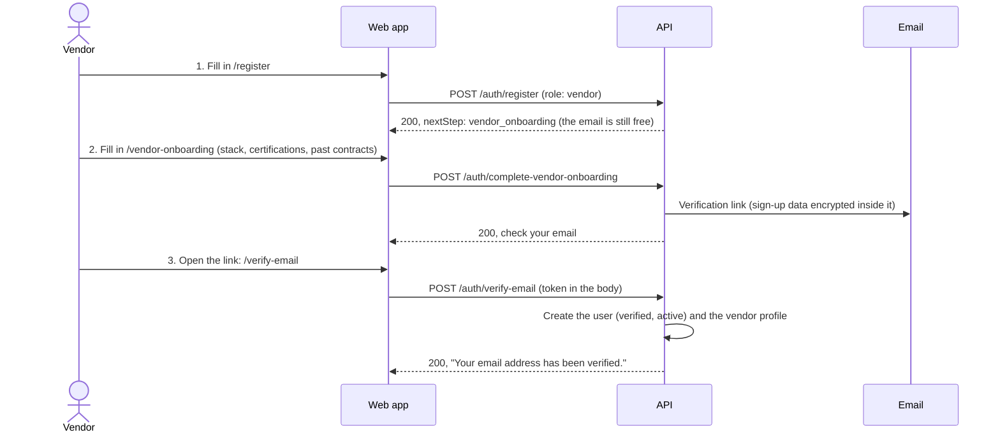

# Authentication and access control

How people prove who they are, what each kind of account may do, and how the platform keeps a stolen link or a stale session from becoming a problem.

## The short version

- Three roles: **vendor**, **reviewer** (a BMA official) and **admin**. Only vendors and BMA officials can sign themselves up; the first admin is promoted by hand.
- Sign-up **stores nothing until the email link is opened**. The details travel, encrypted, inside the link.
- **Google sign-in** is optional. It is on only when Google OAuth credentials are configured, and a matching email address is never enough to sign in to an existing account: its owner connects Google from Settings first.
- Sign-in returns a **signed token**. Every request is also checked against a **server-side session** and the user's current status, so logout, suspension and role changes take effect on the very next request.
- Passwords are **scrypt-hashed**, at least 10 characters, **checked against known data breaches**, and five wrong guesses lock the account for 15 minutes. Per-IP **rate limits** sit on top of that.
- One-purpose links (open a document, unsubscribe) use small **signed tokens** instead of sessions. Verification and password-reset links carry their token in the URL fragment, so it never reaches a server log.

---

## Roles

| Role | Who | How they get it |
| --- | --- | --- |
| `vendor` | A software company or freelancer looking for work (ผู้ขายซอฟต์แวร์) | Self sign-up |
| `reviewer` | A BMA official (เจ้าหน้าที่กรุงเทพมหานคร) | Self sign-up, choosing the BMA official option |
| `admin` | A platform administrator (ผู้ดูแลระบบ) | Promoted by another admin, or by hand in the database for the very first one |

(The `User` schema also lists a `public` role, but the guards reject it. Anonymous visitors simply have no token.)

### What each role can do

This is what the API **enforces**, which is what matters. The UI hides things it knows you cannot use, but it is the API that says no.

| Capability | Anonymous | Vendor | Reviewer | Admin |
| --- | :---: | :---: | :---: | :---: |
| Browse, search, read a TOR and its source document links | ✅ | ✅ | ✅ | ✅ |
| Sign up, sign in, reset a password | ✅ | ✅ | ✅ | ✅ |
| Historical-budget and agency-frequency analytics | | ✅ | ✅ | ✅ |
| Read or edit **own** vendor profile | | ✅ | ✅ | ✅ (anyone's) |
| Qualification match and "why this matched me" | | ✅ | | |
| Save TORs, private notes, compare, alert history | | ✅ | | |
| Review queue: correct, approve, reject, supersede, upload a TOR | | | | ✅ |
| Start and monitor crawls, adapter health, AI job history | | | | ✅ |
| Audit log; list and change users | | | | ✅ |

> [!NOTE]
> The Accounts screen describes the reviewer role as "reviews extracted data before it is published". Today that work is done by **admins**: every review-queue route is admin-only, and a `reviewer` has no extra API permissions beyond a normal signed-in user. Giving reviewers their own slice of the queue would be a small, contained change in `routes/review.routes.ts`.

Admins deliberately cannot use the vendor-only endpoints (saved TORs, qualification match). Those answer "what does this mean for *my company*", which an admin does not have.

---

## Signing up

### Vendors: three steps



Between steps 1 and 2 the draft lives only in the browser's `sessionStorage`. The server performs a read-only check that the email is not already registered, and nothing else.

### BMA officials: two steps

`POST /auth/register` with `role: reviewer` validates the form and emails the verification link immediately (202). Opening the link creates the account.

### Validation rules

| Field | Rule |
| --- | --- |
| Name, organisation, phone | Required, trimmed |
| Email | Must look like an address; stored lower-case; one account per address |
| Password | **At least 10 characters**, not one of a short list of very common passwords (`password`, `password123`, `1234567890`, `qwertyuiop`, `cityofsoftware`, compared case-insensitively), and **not found in a known data breach** (see [Passwords](#passwords)) |
| Role | `vendor` or `reviewer` only |

Registering with an address that already has a *verified* account returns 409 ("An account with this email already exists"). That does reveal whether an address is registered; sign-in and password reset do not.

### The verification link

- Valid for **24 hours**.
- The link is `<APP_URL>/verify-email#token=…`. The token sits in the URL **fragment**, which browsers never send to a server, so it stays out of request logs and `Referer` headers. The page reads it, removes it from the address bar and posts it to `POST /auth/verify-email`, which creates the account: **200** "Your email address has been verified." or **400** "This verification link is invalid or expired."
- Registration data is encrypted with AES-256-GCM, with a key derived from `AUTH_SECRET`, and the token must match its canonical base64url form exactly, so any edited character is rejected before decryption is attempted.
- Opening it twice, or after the account exists, is `invalid`.
- If the same address registered before but never verified (the older flow created unverified users), the verified registration replaces that stale record.

---

## Signing in

`POST /auth/login` with email and password. Checks run in this order:

1. Locked? If `loginLockedUntil` is in the future: **429** ("Too many failed sign-in attempts. Please try again in 15 minutes").
2. Wrong email or password: **401** ("Email or password is incorrect."), the same message for both. A wrong password on a real account increments `failedLoginAttempts`; the fifth failure locks the account for **15 minutes**.
3. Suspended: **403**.
4. Email not verified: **403** with `code: "EMAIL_NOT_VERIFIED"`.
5. Success: counters reset, a `Session` document is created, and the response is `{ user, token }`.

### Rate limits

The account lockout above stops guessing against one account. Per-IP limits stop one address from trying many:

| Limit | Applies to | Allowance |
| --- | --- | --- |
| Sign-in | `POST /auth/login` and the Google sign-in endpoints | 10 requests per IP per 15 minutes |
| Account actions | Every other `POST` under `/auth` (sign-up, verification, resend, password reset) | 20 requests per IP per 15 minutes |
| Writes | Every `POST`, `PUT`, `PATCH` and `DELETE` on the API | 120 requests per IP per minute |

Over a limit, the API answers **429** "Too many requests. Please try again later." with standard `RateLimit` headers, and logs a `rate_limit.*` security event. Reads (`GET`) are never limited. The counters live in the API's memory, so they reset when it restarts and are not shared between instances. Behind a reverse proxy, set `TRUST_PROXY_HOPS=1` so the limits see the visitor's address rather than the proxy's ([Configuration](configuration.md#security)).

---

## Signing in with Google

Optional, and off until `GOOGLE_OAUTH_CLIENT_ID`, `GOOGLE_OAUTH_CLIENT_SECRET` and `GOOGLE_OAUTH_REDIRECT_URI` are all set. Without them the Google buttons report that Google sign-in is not configured on the server.

| Situation | What happens |
| --- | --- |
| **New to the platform** | *Continue with Google* on the sign-up page goes to Google, then back to `/oauth-onboarding`, which asks for name, organisation, phone and role (vendor or BMA official). The account is created at once, already verified (Google vouched for the address), and signed in. A vendor then fills in the capability profile in Settings. The account gets a random password nobody knows; to sign in with a password as well, use *Forgot password* to set one |
| **Already has a password account** | A matching email address is **not** enough. The owner signs in with their password, opens *Settings → Personal information* and connects Google. From then on either way works. Trying Google first gives "this email already has an account; connect Google from Settings" |
| **Google account already connected** | Google sign-in goes straight to a normal session |

How it is kept safe:

- The account is matched by Google's permanent account id (`googleSubject`), never by email. One Google account can be connected to one platform account; connecting it to a second is refused.
- Every round trip to Google carries a **state** value that expires after 10 minutes: a signed value for sign-in, and for connecting an account a hashed, **single-use** record tied to an active, signed-in session, which is re-checked when Google sends the user back.
- Google's answer lands on the API (`GET /auth/google/callback`). The API then hands the browser a one-use token in the URL **fragment**, valid for 60 seconds (10 minutes for the onboarding form), which the web app exchanges for a normal session with `POST /auth/google/complete`. From there the session rules below apply unchanged.

### Anatomy of the session

```
token = base64url(payload) + "." + HMAC-SHA256(payload, AUTH_SECRET)

payload = { sub: userId, role, sid: sessionId, sv: sessionVersion, exp: now + 8 hours }
```

On **every** protected request the API does four things:

1. Verifies the signature in constant time and checks `exp` (8-hour absolute lifetime).
2. Finds the `Session` with that `sid`: not revoked, not past `expiresAt`. In the same step it **slides `expiresAt` forward by 30 minutes** (the idle timeout).
3. Loads the `User`: `status` must be `active`, and `sessionVersion` must equal the token's `sv`.
4. Uses the role **from the database**, not from the token.

Consequences worth knowing:

| Event | Effect |
| --- | --- |
| Logout (`POST /auth/logout`) | Session marked revoked; the token stops working at once. Always returns 204, so a browser can finish signing out even if the API is unreachable |
| 30 minutes idle | Session expires. The web app also signs out after 30 minutes without activity |
| Password reset | `sessionVersion` is incremented and every session is revoked: **all devices are signed out** |
| Admin changes your role or suspends you | `sessionVersion` is incremented: existing sessions die immediately |
| You are promoted by editing the database directly | The server sees the new role on your next request, but the web app's stored user is stale until you sign out and in |
| `AUTH_SECRET` changes | Every token fails verification: everyone is signed out |

Sessions and tokens are removed from MongoDB automatically by TTL indexes after they expire.

---

## Passwords

- Hashed with **scrypt** (16-byte random salt, 64-byte key), stored as `scrypt$<salt>$<key>`. Plain-text passwords are never persisted or logged.
- Verification uses a constant-time comparison.
- Every new password (sign-up and reset) is **checked against known data breaches** using the Have I Been Pwned range API. Only the first five characters of the password's SHA-1 hash leave the server, never the password or its full hash. A breached password is refused (400 "Choose a password that has not appeared in a known data breach."). If the check cannot be reached, the request is refused too (**503**) rather than letting an unchecked password through, so the API needs outbound HTTPS to `api.pwnedpasswords.com`.

### Forgotten password

```
/forgot-password ─► POST /auth/forgot-password ─► email with a 1-hour link
/reset-password#token=… ─► POST /auth/reset-password
```

- The response is **always** the same ("If an account exists for this email, a password reset link has been sent."), whether or not the address is registered, and even if email delivery fails. The endpoint cannot be used to discover who has an account.
- Only verified accounts get a link; at most one request per minute per account; a new request invalidates the previous link.
- The link is valid for **1 hour** and works once. Using it sets the new password, bumps `sessionVersion` and revokes every session.

---

## Signed links

Not everything is a session. Some access is deliberately narrower.

| Token | Authorises | Lifetime | Where it is kept |
| --- | --- | --- | --- |
| **Session token** | Calling protected API routes as you | 8 h absolute, 30 min idle | Browser `localStorage`; the `sessions` collection (by session id) |
| **Pending-registration link** | Creating your account | 24 h | Only inside the email (AES-GCM ciphertext); nothing in the database |
| **Email-verification token** | Verifying an existing, unverified account (legacy resend path) | 24 h | Only its SHA-256 hash is stored |
| **Password-reset token** | Setting a new password once | 1 h | Only its SHA-256 hash is stored |
| **Google sign-in handoff** | Turning a finished Google sign-in into a session, once | 60 s | Only a keyed hash is stored |
| **Google onboarding token** | Completing a new Google account's details, once | 10 min | Only a keyed hash is stored |
| **Document-access token** | Downloading **one** document | **15 min** | Nowhere (stateless HMAC); handed out in `GET /tors/:id/documents` to anyone, and in the admin review record |
| **Unsubscribe token** | Removing the email channel for one vendor | **Never expires** | Nowhere (stateless HMAC) |

All HMAC tokens use the same construction (HMAC-SHA256, base64url, constant-time compare) and the same `AUTH_SECRET`, so there is no second secret to provision.

Verification and reset links, and the Google handoffs, carry their token in the URL fragment (`#token=…`), which reaches the API only in a `POST` body. The document and unsubscribe tokens are query parameters (`?token=…`), so the API's request log records paths without their query strings, and every API response carries `Cache-Control: no-store`.

Why the unsubscribe token never expires: a link in an old, unread email must still work whenever it is finally opened, and the worst case of a leaked one is someone unsubscribing a vendor from *email* (reversible in Settings), not a data exposure.

---

## Managing accounts (admins)

- **List:** `GET /admin/users` returns everyone without password or session data. The Accounts screen shows them.
- **Change:** `PATCH /admin/users/:id` with a `role` (`vendor`, `reviewer`, `admin`) and/or a `status` (`active`, `suspended`).
  - You **cannot change your own role or status**, which stops the last admin locking themselves out.
  - A change bumps the target's `sessionVersion`, ending their sessions at once.
  - Each change writes an audit entry (`user.role.updated` or `user.status.updated`) with before and after values.

### The very first admin

No sign-up path creates an admin. After registering and verifying a normal account, promote it in the database:

```js
db.users.updateOne({ email: "you@example.com" }, { $set: { role: "admin" } })
```

Then sign out and back in. Step-by-step in [Getting started](getting-started.md#7-make-yourself-an-administrator).

---

## What this does not do yet

Better stated plainly than discovered later.

- **Rate limits are per process.** They live in memory: a restart resets them and two API instances would each keep their own count.
- **The token is in `localStorage`.** Convenient and cross-tab, but readable by any script that runs on the page. Nothing renders untrusted HTML today.
- **A document's stored record is public.** `GET /documents/:id` needs no sign-in and returns the whole stored record, extracted text included, even for a TOR that is not published. The file itself is protected: `GET /documents/:id/file` refuses any request without a valid signed link.
- **No second factor, no email-change flow, no "sign out everywhere" button.** (A password reset does sign out everywhere.)
- **No HTTPS in the app.** The API sends HSTS and other security headers, but TLS itself must be terminated at a reverse proxy. Use `https://` for `APP_URL`, `PUBLIC_API_URL` and `CORS_ORIGIN` ([Deployment](deployment.md)).
- **The development secret is public.** Without `AUTH_SECRET`, development mode uses a built-in default that anyone reading the source knows. Production refuses to start without a real one.

The [threat model](threat-model.md) lists each threat with its controls, and [security testing](security-testing.md) says how they are checked.

See [Status and limitations](status.md) for the full list.
