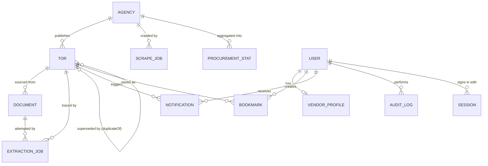

# Database design

The shape of the MongoDB database, and the reasons behind it. Start with the picture, read the principles to learn how decisions were made, then use the per-collection reference when you need a field.

**Stack:** MongoDB Atlas through Mongoose 9. **Models:** `back-end/src/models/`. **Companion docs:** [extraction-pipeline.md](extraction-pipeline.md) (what fills these collections), [architecture.md](architecture.md) (how they are used).

> **Reading the shapes.** Field names below are exactly as stored: `camelCase`, matching the Mongoose models. Collection names are Mongoose's automatic ones: the model name, lower-cased and pluralised, with **no underscores** (`VendorProfile` becomes `vendorprofiles`). Use these in `mongosh`. Shapes are written in a JSON-with-comments style; `A | B` is an enum, and every collection also has `_id`, and `createdAt`/`updatedAt` unless stated.

## At a glance

16 collections, in five groups.

| Group | Model → collection | Holds | Grows with |
| --- | --- | --- | --- |
| **Opportunities** | `Agency` → `agencies` | One document per publishing agency | Number of sources (tiny) |
| | `Tor` → `tors` | **The core entity.** One per procurement notice | Every new listing |
| | `Document` → `documents` | Source files and their extracted text | One or more per TOR |
| **Pipeline records** | `ScrapeJob` → `scrapejobs` | One per crawl run | Every run |
| | `ExtractionJob` → `extractionjobs` | One per AI extraction attempt | Every document attempt |
| | `ProcurementStat` → `procurementstats` | Materialised outlier statistics | Agency × type × year groups |
| **People** | `User` → `users` | Every account, any role | Sign-ups |
| | `VendorProfile` → `vendorprofiles` | A vendor's declared capability and alert preferences | One per vendor |
| **Vendor activity** | `Bookmark` → `bookmarks` | A saved TOR plus its private note | Saves |
| | `Notification` → `notifications` | Alert history | Alerts (expire after 180 days) |
| | `Comparison` → `comparisons` | *Unused* | n/a |
| **Accountability and access** | `AuditLog` → `auditlogs` | Every human decision | Admin actions |
| | `Session` → `sessions` | Server-side sign-in sessions | Sign-ins (TTL) |
| | `EmailVerification` → `emailverifications` | Hashed verification tokens (legacy path) | Rare (TTL) |
| | `PasswordReset` → `passwordresets` | Hashed reset tokens | Resets (TTL) |
| | `VendorOnboarding` → `vendoronboardings` | *Legacy*, from an older sign-up flow | n/a |

## Design principles

- **Reference, don't nest, high-growth or independently-queried entities.** TORs, agencies, vendors and notifications are each queried, filtered and paginated on their own, so they are top-level collections linked by `ObjectId` rather than nested documents.
- **Embed small, bounded, always-read-together data.** A vendor's certifications or a TOR's evaluation criteria are small arrays that are always fetched with their parent, so they are embedded subdocuments rather than separate collections.
- **Denormalise display fields onto hot paths.** `tors` stores `agencyName` alongside `agencyId` so list and search views need no `$lookup` per row.
- **Keep big blobs out of hot documents.** Raw OCR text lives on `documents`, not `tors`, and the PDFs themselves are not in MongoDB at all. This keeps the working set small on a budget Atlas tier.
- **Two lifecycles, never one.** `tors.status` is *our* review workflow; `tors.lifecycle.stage` is *the agency's* procurement stage. They answer different questions.
- **Tri-state where a fact can be unknown.** `lifecycle.isAwarded` and `outlier.isOutlier` are `true`, `false` or `null`; `null` ("unknown / not evaluated") is not `false` ("confirmed no"). Missing values are excluded and counted, never defaulted.
- **Derive what goes stale.** The comment-window *status* (open/closed) changes every midnight, so only the start and end dates are stored. Query it as `start <= now <= end`.
- **Snapshot what must not be rewritten.** A notification keeps the reasons it fired for; a vendor profile keeps a numbered history of capability changes; an audit entry keeps before and after.
- **Expire what has no value later.** Sessions, tokens and notifications carry TTL indexes so storage does not grow without bound.

## How the collections relate



---

## Collections

### `agencies`: who publishes TORs

One document per agency. **Created automatically by the first crawl** of each source (the registry supplies its `code`, names and type); `isActive` hides one from the follow-agency picker.

```jsonc
{
  name: "กระทรวงแรงงาน",                // Thai name (required)
  nameEn: "Ministry of Labour",        // English name (required)
  code: "MOL",                         // short internal code, unique
  agencyType: "district_office" | "department" | "public_enterprise" | "other",   // default "other"
  websiteUrl: String,
  torSources: [{                       // where the crawler looks
    url: String,
    method: "scrape" | "manual",       // default "scrape"
    lastScrapedAt: Date,
    lastStatus: "ok" | "error" | "changed_format"
  }],
  contact: { address: String, phone: String, email: String },   // rarely populated today
  isActive: true
}
```

Indexes: `{ code: 1 }` unique; text index on `name` and `nameEn`.

### `tors`: the core entity

One document per procurement notice.

```jsonc
{
  agencyId: ObjectId,                  // ref agencies
  agencyName: String,                  // denormalised for list views. Crawled TORs carry the
                                       // ENGLISH name ("Ministry of Labour"); hand-created ones the Thai name

  title: String, titleEn: String,

  // OUR workflow (SRS section 9.3). See "Two lifecycles" above.
  status: "discovered" | "extracting" | "pending_review" | "published"
        | "rejected" | "superseded" | "closed" | "archived",     // default "discovered"
  referenceNumber: String,             // as printed in the source; NOT unique across agencies
  description: String,                 // extracted description; distinct from summaryAi.text
  procurementMethod: "e_bidding" | "selection" | "special_method" | "specific_method" | "other",
  projectType: "web_application" | "mobile_application" | "it_system" | "other",   // inferred from the title; unset if no keyword matches
  technologies: [String],              // AI-extracted tags, multikey-indexed
  keyRisks: [String],
  estimatedComplexity: "low" | "medium" | "high",

  budget: {
    amountThb: Number,
    isEstimated: Boolean,              // default true: every budget seen is a published figure, not a contracted one
    vatBasis: "inclusive" | "exclusive" | "unstated"            // default "unstated"
  },

  timeline: {
    announcementDate: Date,
    commentPeriodStart: Date,          // public-comment window; only the dates are stored, never "is it open"
    commentPeriodEnd: Date,
    clarificationMeetingDate: Date,
    submissionDeadline: Date,          // stored at midnight UTC (date only)
    projectDurationDays: Number,
    contractStartDate: Date,
    contractEndDate: Date
  },

  // THE AGENCY'S stage. Scrape-derived, and escalated by the AI when the document says "awarded".
  lifecycle: {
    stage: "plan" | "draft_tor" | "spec" | "price_reference" | "bidding_open" | "awarded" | "cancelled" | "other",
    stageLabel: String,
    isAwarded: Boolean | null,         // null = the source did not say. Never default to false
    signal: "authoritative" | "doc_type" | "title_keyword"     // how the stage was decided (also "ai_content" when written by the AI sweep)
  },

  // Link back to the scraped record. Absent on hand-created TORs.
  sourceRef: {
    sourceId: "dga" | "mol" | "moc" | "itd" | "depa" | "bma_egp2",
    externalId: String,
    identityKey: String,               // the upsert key: stable across runs
    contentHash: String,               // changes when a mutable field changes
    firstSeenAt: Date, lastSeenAt: Date
  },

  qualifications: {
    minContractValueThb: Number,
    requiredCertifications: [String],
    requiredExperienceYears: Number,
    items: [String]                    // one entry per distinct requirement, not one paraphrased paragraph
  },
  evaluationCriteria: [{ criterion: String, weightPercent: Number }],
  deliverables: [String],

  summaryAi: { text: String, model: String, generatedAt: Date, confidence: Number },

  // What the AI sweep produced; distinct from lifecycle/sourceRef (scrape) and review (human).
  extraction: {
    overallConfidence: Number,         // [0,1], recomputed in code. Drives review routing
    fieldConfidence: Map<String, Number>,   // per field key, e.g. "budget" -> 0.42
    modelVersion: String, promptVersion: String,
    ocrUsed: Boolean,
    language: "th" | "en" | "mixed",
    discardedFields: [String],         // dropped for lacking grounding in the source
    humanCorrectedFields: [String],    // never overwritten by re-extraction
    lastProcessedAt: Date,
    lastDocumentId: ObjectId
  },

  // Budget-outlier flag. Tri-state, like isAwarded.
  outlier: {
    isOutlier: Boolean | null,
    reason: "no_budget" | "no_project_type" | "no_year" | "insufficient_comparables" | "within_range" | "outlier",
    basisAgencyId: ObjectId, basisProjectType: String, basisYear: Number,
    comparableCount: Number, deviationPct: Number, evaluatedAt: Date
  },

  source: {
    sourceUrl: String,
    importMethod: "scrape" | "manual",
    discoveredAt: Date
  },
  documentIds: [ObjectId],             // ref documents

  review: {
    extractionStatus: "pending" | "approved" | "rejected",
    reviewedBy: ObjectId, reviewedAt: Date, notes: String
  },

  // 'none' | 'suspected' (linked below, awaiting an admin) | 'confirmed' (resolved to duplicateOf)
  duplicateStatus: "none" | "suspected" | "confirmed",
  duplicateOf: ObjectId,               // the record this one was superseded by
  mergeCandidateIds: [{                // scored candidates. Never auto-merged
    torId: ObjectId, score: Number, titleSimilarity: Number,
    sameAgency: Boolean, sameReferenceNumber: Boolean,
    budgetProximity: Number, dateProximityDays: Number, detectedAt: Date
  }],

  stats: { viewCount: Number, bookmarkCount: Number }   // bookmarkCount is maintained; viewCount is reserved
}
```

**Indexes**, with the query each one serves:

| Index | Serves |
| --- | --- |
| text on `title`, `titleEn`, `summaryAi.text` | Reserved for `$text` search (the API currently uses regular expressions) |
| `{ status, timeline.submissionDeadline }` | Active listings by deadline |
| `{ agencyId, status }` | Per-agency views |
| `{ projectType, technologies }` (multikey) | Search filters |
| `{ budget.amountThb }` | Budget filters and analytics |
| `{ review.extractionStatus }` | The review queue |
| `{ status, createdAt }` | The review queue, oldest first |
| `{ sourceRef.identityKey }` **unique, sparse** | The crawler's upsert key (sparse so hand-created TORs do not collide on null) |
| `{ lifecycle.stage, lifecycle.isAwarded }` | "What can a vendor still act on": the central query |
| `{ timeline.commentPeriodEnd, timeline.commentPeriodStart }` | Live public-comment windows |
| `{ sourceRef.sourceId, sourceRef.lastSeenAt }` | Per-source monitoring and freshness |
| `{ referenceNumber, agencyId }` sparse | Reference numbers are only unique within an agency |
| `{ timeline.announcementDate, agencyId }` | Duplicate pre-filter and outlier year-bucketing |
| `{ outlier.isOutlier }` | The outlier list |
| `{ duplicateStatus }` | Finding suspected duplicates |

### `documents`: the source files

Raw files (PDF or scanned image) and their extracted text, kept apart from `tors` so large OCR text does not bloat the hot document. The PDF **bytes** are not here: they are in the blob store, referenced by `origin.storageKey`.

```jsonc
{
  originalName: String, mimeType: String, size: Number,

  // The AI pipeline's own lifecycle. The extraction sweep's work queue is
  // find({ status: "uploaded" }), so it must stay pipeline-only.
  status: "uploaded" | "extracted" | "summarized" | "error",     // default "uploaded"
  extractedText: String,               // the transcription (or OCR text) the fields were grounded against
  summary: String,
  metadata: { pageCount: Number, confidence: Number },

  torId: ObjectId,                     // ref tors; null until linked
  agencyId: ObjectId,
  uploadedBy: ObjectId,                // ref users; null if from the crawler

  origin: {                            // provenance for crawled/uploaded files
    sourceUrl: String,                 // where it was downloaded from, before redirects
    label: String,                     // the site's own label for it
    storageKey: String,                // key in the blob store: <sourceId>/<sha[0:2]>/<sha256><ext>
    sha256: String,                    // content hash: dedupes identical bytes across sources and runs
    downloadedAt: Date,
    insecureTransport: Boolean         // true when the download needed TLS verification off
  },

  extraction: {                        // retry bookkeeping
    attempts: Number,                  // automatic retries stop at EXTRACTION_MAX_ATTEMPTS
    lastAttemptAt: Date,
    lastError: String
  }
}
```

> [!NOTE]
> `Document` also still carries fields from the **first, now-replaced search implementation**: `projectTitle`, `tenderStatus`, `datePublished`, `agency`, `budget` (a string), `deadline`, `technology`, `projectType`. Search reads `tors` now, so these are only populated by the legacy `POST /documents/upload` and the mock seed. Do not build on them.

Indexes: `{ torId }`; `{ status, createdAt }` (the sweep's queue, oldest first); `{ origin.sha256 }` sparse; `{ origin.storageKey }` sparse.

### `extractionjobs`: one AI attempt

One attempt to turn one `document` into structured `tor` fields. Separate from `scrapejobs` on purpose: a scrape job is a whole crawl; this is one document's extraction. A document can have several (a retry, or a future re-extraction), and each keeps the model and prompt version, per-field confidence and cost that a published record needs in order to stay traceable.

```jsonc
{
  documentId: ObjectId, torId: ObjectId,
  status: "running" | "success" | "partial" | "failed",
  startedAt: Date, finishedAt: Date,
  modelVersion: String, promptVersion: String,
  ocrUsed: Boolean, language: "th" | "en" | "mixed",
  overallConfidence: Number,
  fieldConfidence: Map<String, Number>,
  discardedFields: [{ field: String, reason: String }],
  processingTimeMs: Number, estimatedCostThb: Number,
  routedTo: "pending_review" | "published",
  errors: [String]
}
```

Indexes: `{ documentId, startedAt: -1 }`, `{ torId, startedAt: -1 }`, `{ status, startedAt: -1 }`.

### `scrapejobs`: one crawl run

The pipeline's audit trail. When a listing looks wrong or a source goes quiet, this is where you find out whether the run failed, succeeded but found nothing, or the site simply had nothing new.

```jsonc
{
  agencyId: ObjectId,
  sourceId: "dga" | "mol" | "moc" | "itd" | "depa" | "bma_egp2",
  trigger: "manual" | "scheduled" | "api",
  startedAt: Date, finishedAt: Date,
  status: "running" | "success" | "partial" | "failed" | "skipped",   // skipped = refused before starting (the ToS gate); NOT a failure
  torsFound: Number, torsNew: Number, torsUpdated: Number, torsUnchanged: Number,
  attachmentsStored: Number,
  stageCounts: Map<String, Number>,    // rows per lifecycle stage
  preAwardCount: Number,               // rows a vendor could still act on
  newestAnnouncedAt: Date,             // the freshness check: a 200 OK proves nothing about recency
  complianceOverride: { approvedBy: String, reason: String, tosStatus: String },   // only when a prohibited source was deliberately run
  errors: [String]                     // capped at 100
}
```

Indexes: `{ agencyId, startedAt: -1 }`, `{ sourceId, startedAt: -1 }`, `{ status, startedAt: -1 }`.

### `procurementstats`: materialised outlier statistics

Written by the outlier job for every agency × project type × year group that has enough records. It is a materialised summary of the groups the job evaluated.

```jsonc
{
  agencyId: ObjectId, projectType: String, year: Number,
  count: Number, avgBudgetThb: Number, medianBudgetThb: Number, minBudgetThb: Number, maxBudgetThb: Number,
  outlierTorIds: [ObjectId],           // budgets outside the IQR fences (Tukey's rule, not standard deviations)
  updatedAt: Date
}
```

Index: `{ agencyId, projectType, year }` unique. The historical-budget and frequency reports query `tors` directly rather than reading this collection ([Analytics](analytics.md)).

---

### `users`: every account

```jsonc
{
  email: String,                       // unique, stored lower-case
  passwordHash: String,                // scrypt$<salt>$<key>
  role: "vendor" | "reviewer" | "admin" | "public",   // default "vendor". "public" is listed but rejected by the guards
  name: String, organization: String, phone: String,
  emailVerified: Boolean,
  status: "pending_verification" | "active" | "suspended",
  sessionVersion: Number,              // incremented to end all of a user's sessions at once
  failedLoginAttempts: Number,
  loginLockedUntil: Date,              // set after 5 failures; 15 minutes
  lastLoginAt: Date
}
```

Index: `{ email }` unique (from the schema), `{ role }`. Role-specific data lives in `vendorprofiles`.

### `vendorprofiles`: a vendor's declared capability

One-to-one with a `users` document. **Self-declared and never shown as verified.**

```jsonc
{
  userId: ObjectId,                    // unique
  organizationType: "company" | "freelancer",
  companyName: String,
  techStack: [String], serviceCategories: [String],
  yearsExperience: Number, teamSize: Number,
  certifications: [{ name, issuer }],             // obtainedDate / expiryDate exist in the schema but nothing sets them
  pastContracts: [{ agencyName, projectTitle, contractValueThb, year }],   // evidenceUrl likewise reserved
  totalContractValueThb: Number,       // derived: sum of pastContracts

  // The delivery settings and watchlist: NOT part of the versioned capability set.
  interests: {
    agencyIds: [ObjectId],             // followed agencies
    keywords: [String],                // followed keywords (matched against the TOR title)
    projectTypes: [String],            // reserved: nothing writes it yet
    technologies: [String],            // reserved
    budgetRange: { minThb: Number, maxThb: Number }    // reserved
  },
  notificationPrefs: {
    channels: ["email", "in_app"],     // 'email' is removed by the one-click unsubscribe
    frequency: "instant" | "daily_digest",       // default "instant"
    minMatchScore: Number              // reserved: nothing reads it yet
  },

  // Capability changes are versioned so a match can be explained later.
  profileVersion: Number,              // starts at 1
  profileHistory: [{ version: Number, effectiveAt: Date, profile: Mixed }]   // a full validated copy per version
}
```

Reserved but unused in the schema: `companyNameEn`, `registrationNumber`, `companySize`, `foundedYear`.

Indexes: `{ userId }` unique, `{ techStack }`, `{ interests.technologies }`.

### Auth support collections

All carry TTL indexes (`expiresAt` with `expireAfterSeconds: 0`), so MongoDB deletes expired records by itself. See [Authentication](authentication.md).

| Collection | Holds | Key fields |
| --- | --- | --- |
| `sessions` | One per sign-in | `userId`, `sessionId` (unique), `lastActivityAt`, `expiresAt` (slides forward 30 min per request), `revokedAt` |
| `emailverifications` | Hashed verification tokens for an *existing, unverified* user (legacy path) | `userId`, `tokenHash` (unique), `sentAt`, `expiresAt`, `usedAt` |
| `passwordresets` | Hashed reset tokens | `userId`, `tokenHash` (unique), `sentAt`, `expiresAt` (1 h), `usedAt` |
| `vendoronboardings` | **Legacy**; only referenced to clean up records from an older sign-up flow | `userId`, `tokenHash`, `expiresAt`, `usedAt` |

Only the SHA-256 **hash** of a token is stored. New registrations create no document at all until the email link is opened.

### `bookmarks`: saved TORs

```jsonc
{ userId: ObjectId, torId: ObjectId, note: String /* ≤ 2,000 chars, default "" */, createdAt: Date }
```

Index: `{ userId, torId }` unique. The note belongs to the *saved relationship*, never to the TOR: each vendor keeps their own private note on the same TOR. Saving increments `tors.stats.bookmarkCount` only when a bookmark is actually created.

### `comparisons`

Defined in the schema (`userId`, `name`, `torIds`) but **not used**. A comparison is computed from the vendor's current shortlist on demand and is not stored (`POST /comparisons/preview`).

### `notifications`: alert history

```jsonc
{
  userId: ObjectId, torId: ObjectId,
  type: "comment_stage" | "announcement_stage"          // in use
      | "new_match" | "deadline_reminder" | "status_change",   // reserved
  matchScore: Number,
  reasons: [{ type, label, detail }],  // SNAPSHOT of why it fired; a later profile edit must not rewrite it
  relatedNotificationId: ObjectId,     // for announcement_stage: the vendor's earlier comment_stage alert, if any
  channel: "email" | "in_app",
  status: "queued" | "sent" | "failed" | "read" | "cancelled",
  sentAt: Date, readAt: Date,
  createdAt: Date                      // (no updatedAt)
}
```

Indexes:

- `{ userId, status, createdAt: -1 }` for a vendor's history and the digest's `queued` rows.
- `{ torId }`.
- `{ userId, torId, type }` **unique, partial** (only `comment_stage` and `announcement_stage`): at most one alert per vendor per TOR per stage. A duplicate-key error on insert means "already notified".
- `{ createdAt }` **TTL, 180 days**.

### `auditlogs`: what people did

```jsonc
{
  actorId: ObjectId,                   // ref users
  action: "tor.import" | "tor.approve" | "tor.reject" | "tor.supersede" | "tor.correct_fields"
        | "user.role.updated" | "user.status.updated",
  entityType: "tor" | "vendor" | "agency" | "user",
  entityId: ObjectId,
  before: Mixed, after: Mixed,         // partial prior and new values
  ipAddress: String,
  createdAt: Date
}
```

Indexes: `{ entityType, entityId, createdAt: -1 }`, `{ actorId, createdAt: -1 }`. It records only what **people** did; the origin of an AI-written value is traced through `tors.extraction` and `extractionjobs`.

---

## How features map to collections

| Feature | Collections |
| --- | --- |
| Discovery (crawl, manual upload) | `scrapejobs`, `agencies`, `tors` (`sourceRef`, `source`), `documents` |
| AI extraction and summary | `documents`, `extractionjobs`, `tors` (`extraction`, `summaryAi`, `qualifications`, …) |
| Review and publishing | `tors` (`status`, `review`), `auditlogs` |
| Duplicate detection | `tors` (`duplicateStatus`, `mergeCandidateIds`, `duplicateOf`) |
| Search, browse, detail | `tors`, `documents` (source files), `agencies` |
| Accounts and sign-in | `users`, `sessions`, `emailverifications`, `passwordresets` |
| Vendor profile and matching | `vendorprofiles`, `tors` |
| Alerts and digest | `notifications`, `vendorprofiles` (`notificationPrefs`, `interests`), `tors` |
| Saved TORs, notes, compare, calendar | `bookmarks`, `tors` |
| Pricing analytics and outlier flags | `tors` (`budget`, `timeline`, `outlier`), `procurementstats` |
| Admin tooling | `auditlogs`, `users`, `scrapejobs` |

## Implementation status

| Piece | State |
| --- | --- |
| All 16 Mongoose models and their indexes | Built (indexes are created at start-up by Mongoose) |
| Review queue, field correction, approve, reject, supersede, manual TOR creation | Built; admin-only |
| Audit log (read and write) | Built |
| Accounts, sessions, password reset, role management | Built |
| Qualification match, match reasons, alert fan-out, daily digest | Built ([details](notifications-and-matching.md)) |
| Search with filters and sort | Built (regular expressions; two known sort bugs and one filter bug, see [Status](status.md#known-bugs)) |
| Pricing analytics and outlier flags | Built |
| Scheduler | Built; off unless `SCHEDULER_ENABLED=true` |
| Atlas Search / `$text` for Thai | **Not used**; indexes exist but the API uses regular expressions |
| Object storage for PDFs | **Not built**; local disk behind a `BlobStore` interface |

## Useful queries (`mongosh`)

Use your database name (the path part of `MONGODB_URI`, for example `city_of_software`).

```js
use city_of_software

// How many TORs in each state?
db.tors.aggregate([{ $group: { _id: "$status", n: { $sum: 1 } } }])

// The review queue, oldest first
db.tors.find({ status: "pending_review" }, { title: 1, "extraction.overallConfidence": 1 }).sort({ createdAt: 1 })

// Records the AI was unsure about
db.tors.find({ "extraction.overallConfidence": { $lt: 0.75 } }, { title: 1, status: 1 })

// Published and still open for bids
db.tors.find({ status: "published", "timeline.submissionDeadline": { $gte: new Date() } }, { title: 1, "timeline.submissionDeadline": 1 })

// Suspected duplicates waiting for an admin
db.tors.find({ duplicateStatus: "suspected" }, { title: 1, mergeCandidateIds: 1 })

// Budget outliers
db.tors.find({ "outlier.isOutlier": true }, { title: 1, budget: 1, "outlier.deviationPct": 1 })

// Recent crawls that logged errors
db.scrapejobs.find({ "errors.0": { $exists: true } }).sort({ startedAt: -1 }).limit(5)

// Documents the AI gave up on
db.documents.find({ status: "uploaded", "extraction.attempts": { $gte: 3 } }, { originalName: 1, "extraction.lastError": 1 })

// Who changed this TOR?
db.auditlogs.find({ entityType: "tor", entityId: ObjectId("…") }).sort({ createdAt: -1 })

// Promote the first admin
db.users.updateOne({ email: "you@example.com" }, { $set: { role: "admin" } })
```

## Atlas-specific notes

- **Search.** The current search is a regular-expression match, which works for Thai because it needs no word segmentation, but does no ranking, stemming or fuzziness. If search quality for Thai plus English matters, use **Atlas Search** (Lucene-based); plain `$text` indexes do not tokenise Thai well. The text indexes on `tors` and `agencies` exist but nothing queries them yet.
- **Files.** Keep PDFs and images out of MongoDB (no GridFS), which suits a budget-conscious Flex-tier cluster. Today they sit on local disk behind a `BlobStore` interface and are referenced by `documents.origin.storageKey`; swapping in Cloud Storage means replacing one file.
- **Budget.** The proposal budgets a THB 800 a month **Atlas Flex tier**. Keep the working set small: no raw OCR text or AI prompt and response payloads on the hot `tors` document (hence `documents`), notifications expire after 180 days, and sessions and tokens expire on their own.
- **Indexes** are built by Mongoose when the API starts. On a large collection, adding a new index builds in the background but is not free: do it off-peak.
