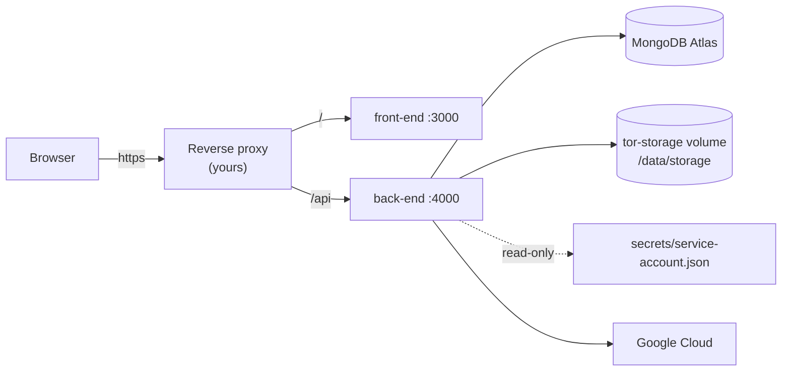

# Deployment

Run the whole stack on a server with Docker. This page covers configuring it, starting it, keeping it running, and the things that bite people the first time.

## What you are deploying

`docker-compose.yml` runs two services:

| Service | Image | Port | Notes |
| --- | --- | --- | --- |
| `back-end` | Built from `back-end/Dockerfile` | 4000 | The API, the crawler, the AI sweep and the scheduler, in one process |
| `front-end` | Built from `front-end/Dockerfile` | 3000 | The Next.js web app |

Each has a multi-stage `Dockerfile` that builds on **Node 22** and runs as the non-root `node` user. The containers also drop all Linux capabilities and set `no-new-privileges`. Both have health checks.

**MongoDB is not part of the stack.** The API connects to MongoDB Atlas through `MONGODB_URI`, so the Atlas **network access list must allow the server's IP address**.

You need **Docker with Compose v2.24 or newer** (the compose file uses an optional `env_file`).



---

## 1. Configure

```bash
cp .env.example .env
```

Fill in `.env`. It is git-ignored, and the `.dockerignore` files keep it, `service-account.json`, `node_modules` and `storage/` out of every image: **secrets reach the containers at run time only**.

| Setting | What it is |
| --- | --- |
| `MONGODB_URI` | MongoDB Atlas connection string. **Required.** |
| `AUTH_SECRET` | Long random string that signs sessions and email links (`openssl rand -base64 48`). **Required**: the API will not start in production without it. |
| `CORS_ORIGIN`, `APP_URL`, `PUBLIC_API_URL` | The URLs the stack is served from. `PUBLIC_API_URL` is where a **browser** reaches the API, including `/api`. It is built into the front-end, so after changing it run `docker compose up --build`. Use HTTPS URLs on a real deployment: the links in emails are built from them. |
| `GMAIL_USER` and `GMAIL_APP_PASSWORD`, or `RESEND_API_KEY` and `EMAIL_FROM` | Email delivery. Sign-up and password reset need one of them in production. |
| `GCP_PROJECT_ID`, `GCP_LOCATION`, `DOC_AI_PROCESSOR_ID`, `VERTEX_AI_*` | Google Cloud. Optional: with `GCP_PROJECT_ID` empty, every AI call uses the built-in stub and sends the record to manual review. |
| `SCHEDULER_ENABLED` | `false` unless you set it to `true`. See [the scheduler](#the-scheduler). |

Put the Google Cloud service account key at `secrets/service-account.json` (git-ignored). It is mounted read-only into the back-end and **must be readable by user ID 1000**.

Any other back-end setting from [`back-end/.env.example`](../back-end/.env.example) (`EXTRACTION_*`, `CRON_*`, …) can be added to `.env` and is passed through to the back-end. Every variable is described in [Configuration](configuration.md).

> [!TIP]
> Do not copy `back-end/.env.example` over the root `.env`. They are different files for different purposes: the root one feeds Docker Compose, the back-end one feeds `npm run dev`.

## 2. Build and start

```bash
docker compose up --build -d
docker compose ps
```

Both services report `healthy` within about a minute. The web app is at <http://localhost:3000> and the API's health check at <http://localhost:4000/api/health> (change the ports with `FRONTEND_PORT` and `BACKEND_PORT`; if you change `BACKEND_PORT`, change `PUBLIC_API_URL` to match).

If either service does not become healthy, read the log:

```bash
docker compose logs -f back-end
```

## 3. Create the first administrator

Nothing creates an admin automatically. Register a normal account on the site, open the verification link, then promote it in MongoDB:

```js
db.users.updateOne({ email: "you@example.org" }, { $set: { role: "admin" } })
```

Sign out and back in. See [Authentication](authentication.md#the-very-first-admin).

## 4. Update

```bash
git pull
docker compose up --build -d
```

To roll back, check out the previous commit or tag and run the same command. There is no migration step: Mongoose builds any new indexes at start-up. Be careful rolling back across a change that renamed or reshaped a field, because the stored data will not be converted back.

---

## Running it for real

- **The daily collection is off by default.** Set `SCHEDULER_ENABLED=true` in `.env` on the deployed environment only. The cron expressions are read in `APP_TIMEZONE` (`Asia/Bangkok` by default).
- **Run exactly one back-end.** The scheduler's overlap lock lives in memory, so a second instance would repeat every crawl. Scaling out needs a database-backed lock first (see [docs/extraction-pipeline.md](extraction-pipeline.md)).
- **Downloaded PDFs** are written to `EXTRACTION_STORAGE_DIR`, which is the `tor-storage` Docker volume mounted at `/data/storage`. Restarting, rebuilding and `docker compose down` keep it; `docker compose down -v` deletes it. For now the files stay on that volume rather than in object storage, so back the volume up with the rest of the server.
- **The extraction CLI** runs inside the deployed container, for example `docker compose exec back-end node dist/extraction/cli.js --list`.
- Put a TLS-terminating reverse proxy in front of the app before public release ([an example](#a-reverse-proxy-example)). It must redirect browser HTTP traffic to HTTPS, keep the API port inaccessible from the public internet, and set `TRUST_PROXY_HOPS=1` on the API only when it is the one trusted proxy immediately upstream. Keep the value at `0` for local or direct access. The API already sends HSTS, CSP and related headers, but a TLS certificate and reverse-proxy network isolation are deployment requirements.

CI builds both images on every pull request and checks that the stack starts and reports healthy.

---

## The scheduler

With `SCHEDULER_ENABLED=true` the API registers eight jobs when it starts, **after** MongoDB connects: five crawls (daily, DEPA weekly), the AI extraction sweep every 30 minutes, outlier analysis daily, and the daily digest. The full table is in [Architecture](architecture.md#scheduled-jobs); the expressions are `CRON_*` settings.

What to expect:

- **Nothing runs on its own while it is off**, so there are no crawls, no AI processing, and therefore **no alerts and no daily digest**.
- Start-up logs `registered crawl for "mol" on schedule "0 3 * * *"` for each job. If you do not see these lines, it is not running.
- An invalid cron expression stops the API from booting, on purpose.
- Each job runs under a lock, so a long crawl is not started a second time. The lock is per process: this is why there must be one back-end.
- The eGP BMA2 source is never scheduled.
- A first full run is large. `EXTRACTION_MAX_DOCUMENTS` (a total cap on documents) is a handy brake while you are watching costs.

Crawl and AI-extraction outcomes are recorded on `ScrapeJob` and `ExtractionJob` records, visible in the admin screens and at `GET /api/extraction/jobs` and `/ai-jobs`.

## Backups

Two things hold state, and only one of them is in MongoDB.

**1. The database.** Use Atlas backups (a paid-tier feature) or dump it yourself:

```bash
mongodump --uri "$MONGODB_URI" --out backup-$(date +%F)
```

**2. The PDFs.** They live in the `tor-storage` volume, not in MongoDB. Find its real name first (Compose prefixes it with the project name), then archive it:

```bash
docker volume ls | grep tor-storage
docker run --rm -v city-of-software_tor-storage:/data -v "$PWD":/backup alpine \
  tar czf /backup/tor-storage-$(date +%F).tgz -C /data .
```

The PDFs are public documents re-fetchable from their sources, so losing them is recoverable but slow. **Manually uploaded documents are not re-fetchable**, so those matter most.

The admin **Export** screen is a demo and is not a backup.

## A reverse proxy example

A single hostname serving the web app at `/` and the API at `/api` keeps the browser on one origin. Here is a Caddy example (Caddy obtains the TLS certificate for you). It is an illustration, not a configuration the project tests:

```
portal.example.org {
    handle /api/* {
        reverse_proxy localhost:4000
    }
    handle {
        reverse_proxy localhost:3000
    }
}
```

The matching `.env`:

```ini
APP_URL=https://portal.example.org
CORS_ORIGIN=https://portal.example.org
PUBLIC_API_URL=https://portal.example.org/api
```

Things the proxy must allow:

- **Request bodies up to 20 MB** (document uploads). nginx's default is 1 MB: set `client_max_body_size 20m;`.
- **Long requests.** `POST /api/extraction/sources/:id/run` holds the connection until the crawl ends, which can be minutes. Raise the proxy's read timeout, or run long crawls from the CLI.
- Pass the original host and protocol headers if you later add anything that depends on them.

## Pre-launch checklist

- [ ] `AUTH_SECRET` is a fresh random value, not copied from anywhere
- [ ] `PUBLIC_API_URL`, `APP_URL` and `CORS_ORIGIN` are HTTPS and agree with each other
- [ ] The web image was built **after** `PUBLIC_API_URL` was final
- [ ] An email provider is configured, and you have received a real verification email
- [ ] Atlas allows the server's IP, and no wider than needed
- [ ] `secrets/service-account.json` exists, is readable by uid 1000, and is not in git
- [ ] You have promoted an admin and signed in as them
- [ ] `SCHEDULER_ENABLED=true` on this server and **only** this server, with exactly one back-end
- [ ] `EXTRACTION_AUTO_PUBLISH_ENABLED` is still `false`
- [ ] Backups of the database and the `tor-storage` volume are scheduled
- [ ] The reverse proxy permits 20 MB bodies and long requests
- [ ] You have run `docker compose ps` and both services are `healthy`

## Hardening you already get

Containers run as a non-root user, with all capabilities dropped and `no-new-privileges`. The application code in the back-end image is owned by root so the API cannot rewrite itself; only the storage directory is writable. Secrets are mounted or passed at run time and excluded from images by `.dockerignore`. Passwords are scrypt-hashed and sessions can be revoked server-side. What is **not** covered, such as general rate limiting and TLS, is listed in [Authentication](authentication.md#what-this-does-not-do-yet).
