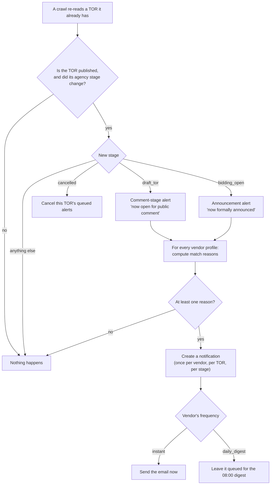

# Notifications and matching

How the platform decides who to tell about a TOR, what it tells them, and how it answers the two questions every vendor asks of a listing: *"why am I seeing this?"* and *"can I even bid on it?"*

## In plain words

Two different engines, answering two different questions. They are deliberately separate, and mixing them up is the easiest way to misunderstand the product.

| Question | Engine | Looks at | Used for |
| --- | --- | --- | --- |
| **"Why was this shown to me?"** | Match reasons (`matching/matchReasons.ts`) | The TOR's technologies, project type, budget and agency against **your interests** | Deciding who gets an alert; the reasons shown on the dashboard and detail page |
| **"Do I clear its requirements?"** | Qualification match (`matching/qualificationMatch.ts`) | The TOR's stated certifications, minimum contract value and experience against **your declared capability** | The qualification panel on the TOR detail page |

Both follow the same rule as the rest of the system: **absent stays absent.** If the TOR does not state something, or you have not declared something, that dimension is skipped or reported as *undetermined*. It is never treated as a match, and never treated as a miss.

---

## Why did this match me?

`computeMatchReasons(tor, profile)` checks five dimensions and returns the ones that matched, each with a human-readable explanation (in Thai, as the UI is).

| Dimension | Matches when | Needs on the TOR | Needs on your profile |
| --- | --- | --- | --- |
| `technology` | Any technology the TOR requires equals one you list (trimmed, case-insensitive) | `technologies` (AI-extracted) | `techStack` (or `interests.technologies`) |
| `project_type` | The TOR's project type is one you follow | `projectType` | `interests.projectTypes` |
| `budget` | The TOR's budget falls inside your range | `budget.amountThb` | `interests.budgetRange` |
| `agency` | The TOR's agency is on your followed list | `agencyId` | `interests.agencyIds` |
| `keyword` | The TOR's **title** contains one of your followed keywords (case-insensitive) | `title` | `interests.keywords` |

**Score** = matched dimensions ÷ 5, so `0.4` means two of five. It is an equal-weight placeholder, not a ranking model.

An alert is created when **at least one** dimension matches.

> [!NOTE]
> **What a vendor can actually set today.** The settings screen lets you edit your technology stack (profile), **followed agencies** and **followed keywords**. Nothing yet writes `interests.projectTypes` or `interests.budgetRange`, so the `project_type` and `budget` dimensions are built and tested but cannot match anyone. In practice the highest reachable score is **0.6** (technology + agency + keyword).
>
> Also, `technology` needs the TOR to *have* technologies, which comes from the AI extraction. Without Google credentials, technology never matches, while agency and keyword follows still work because they use only the scraped title and agency.

### Where reasons appear

- **In an alert**, as a snapshot taken when the alert fired. Editing your profile later does **not** rewrite why an old alert was sent.
- **On the TOR detail page**, computed live (`GET /tors/:id/match-reasons`), for a TOR that may never have triggered an alert.
- **On the dashboard**, with each alert in your history.

---

## Can I bid on this?

`matchQualifications(tor.qualifications, profile)` compares three things the TOR may state:

| Requirement | TOR states | Your profile declares | Result |
| --- | --- | --- | --- |
| `certification` | Each required certification by name | Your certifications | Case-insensitive name match |
| `contract_value` | A minimum accumulated contract value | `totalContractValueThb` (the sum of your past contracts) | `declared ≥ required` |
| `experience_years` | Minimum years of experience | `yearsExperience` | `declared ≥ required` |

Each requirement is exactly one of:

| Status | Meaning |
| --- | --- |
| `met` | You declared a value that clears the threshold |
| `not_met` | You declared a value and it falls short; a `gap` sentence names the shortfall, for example *"requires accumulated contract value of at least 1,000,000 THB but your profile states 200,000 THB"* |
| `undetermined` | The TOR states a requirement but your profile does not declare the matching value. **Never guessed** either way |

A requirement the TOR does not state is left out entirely. The roll-up `overallStatus` is `all_met`, `gaps_found`, `undetermined` or `no_requirements`.

> [!IMPORTANT]
> **The platform never makes an eligibility decision** (requirement FR-VEN-01). Nothing in this module's output, and nothing the UI renders from it, says "eligible", "ineligible" or "disqualified". `overallStatus` is a summary of facts, not a verdict. Whether you may bid is the agency's call, and your profile is self-declared and never shown as verified.

Guests get a 401 from this endpoint; the web app uses that to show a "register to see how you match" prompt instead.

### Profile completeness

A separate, transparent checklist that tells you which missing facts would make matching more useful. It changes nothing about matching itself.

| Field | Weight | Counted for |
| --- | ---: | --- |
| Organisation type chosen | 10 | Everyone |
| Company name | 10 | Companies only |
| Technology stack | 25 | Everyone |
| Service categories | 20 | Everyone |
| Years of experience | 15 | Everyone |
| Certifications | 10 | Everyone |
| Past contracts | 10 | Everyone |

`score = round(earned ÷ applicable × 100)`. A freelancer's total is 90, because the company-name row does not apply to them. The dashboard shows the score and the list of what is missing.

### Profile versions

Every change to your **capabilities** (stack, categories, experience, team size, certifications, past contracts) creates a new numbered version and keeps the old one in `profileHistory`. That way a match can later be explained against the profile that was in effect at the time. The save also takes an optional `expectedVersion`, so two browser tabs cannot silently overwrite each other (the second gets a 409).

**Delivery settings** (alert frequency, followed agencies and keywords) are *not* versioned. They are preferences, not facts about your company, so they simply take effect going forward.

---

## When an alert is sent

Alerts are triggered by **the crawler noticing a stage change on a published TOR**. Nothing else sends them.

The practical consequences, because they surprise people:

- **Approving a TOR does not send an alert.** The trigger is a *change* seen on a later crawl, and only for TORs that are already published. A TOR that is approved while already at `draft_tor` will not alert anyone unless its stage changes later.
- **A new listing is a new TOR.** If an agency posts the next stage of a project as a separate listing, the crawler creates a fresh TOR, and creation never alerts. Only the *same* listing changing stage does. This is the most important limitation in the alerting design; see [Status](status.md#known-gaps).
- **Alerts depend on crawls running.** With `SCHEDULER_ENABLED=false` nothing crawls on its own, so nothing alerts, and the daily digest never goes out. Manual runs from the admin screen or the CLI also trigger alerts.
- **Each vendor is alerted at most once per TOR per stage**, enforced by a unique index. Re-crawling the same change is harmless.
- **The announcement alert refers back** to the vendor's earlier comment-stage alert for the same TOR, when one exists ("you were notified during the comment period, and it is now formally announced"). Direct-appointment procurement skips the comment stage, so there it reads as a standalone announcement.
- **A cancelled TOR cancels its queued alerts**, so a digest never advertises something withdrawn.

### What the email says

Subject: `[City of Software] <title> — <stage>` where the stage is *entered the public-comment period* or *formally announced*. Body: title, agency, estimated budget, the reasons it matched you, a link to the TOR page, and an unsubscribe link in the footer. Emails are in Thai, matching the UI.

The daily digest is one email per digest vendor: *"Summary of projects matching you today (N items)"*, a list of titles and agencies with links.

### Instant or daily digest

Vendors pick in **Settings → alert frequency**.

| Frequency | What happens to a new alert |
| --- | --- |
| `instant` | The notification is created and the email is sent immediately, in the background, so a slow mail server can never stall a crawl. Status becomes `sent` or `failed` |
| `daily_digest` | The notification stays `queued`. At `CRON_DIGEST` (08:00 by default) all of a vendor's queued alerts go out in one email and become `sent` (or `failed`) |

Every alert also appears in the **in-app** history on the dashboard, whatever the email setting.

### Unsubscribing

Every alert email has a one-click link: `…/api/vendor-profiles/unsubscribe?token=…`. Clicking it needs no sign-in. It removes the **email** channel from the vendor's preferences and redirects to a confirmation page.

- It stops email only; **in-app alerts and the account continue**.
- It takes effect for the next dispatch, immediately: the digest job skips anyone who unsubscribed after their alert was queued, and new alerts for an unsubscribed vendor are created as in-app only.
- The link never expires (a link in an old email must still work) and is signed, so it cannot be forged for someone else.

### Statuses

| `status` | Meaning |
| --- | --- |
| `queued` | Waiting for the digest |
| `sent` | Emailed, or in-app only for an unsubscribed vendor |
| `failed` | The email could not be sent: a delivery error, an inactive account, or, in production, no email provider configured. The in-app row remains. (In development with no provider the email is printed to the API terminal and the row is marked `sent`.) |
| `read` | Reserved |
| `cancelled` | The TOR was cancelled before the digest went out |

Notifications are deleted automatically after **180 days**.

---

## Related

- [Authentication](authentication.md#signed-links): how the unsubscribe token works
- [Extraction pipeline](extraction-pipeline.md): where stage changes come from
- [Vendor guide](guides/vendor-guide.md#alerts): the same topic from the vendor's seat
- [Configuration](configuration.md#scheduler): `SCHEDULER_ENABLED` and `CRON_DIGEST`
